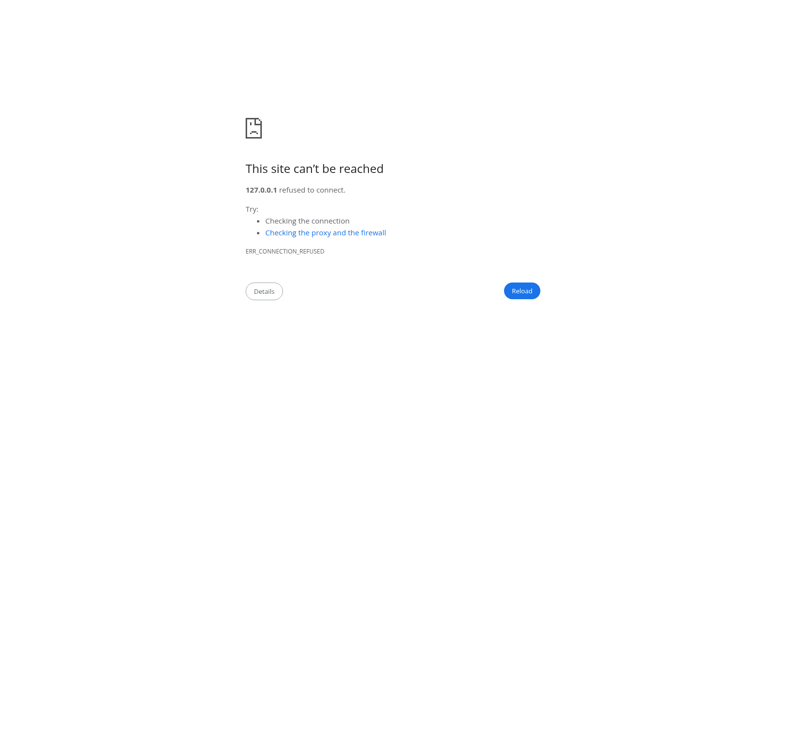

# La petite jauge

Application locale pour suivre les trajets, estimer la consommation et noter les pleins d'un véhicule. Les données sont conservées en local dans une base SQLite.



## Fonctions

- Configurer des jours récurrents pour chaque trajet depuis les réglages, puis appliquer ces règles à la semaine de la date active avec « Ajouter cette semaine ».
- Consulter les kilomètres, le coût estimé et les pleins payés pour le mois affiché, avec comparaison au mois précédent.
- Voir les kilomètres, litres et coût estimés depuis le dernier plein jusqu'au jour actif.
- Voir jusqu'à deux noms de trajets directement dans chaque case du calendrier.
- Sélectionner plusieurs dates avec Maj ou Ctrl/Cmd pour consulter leur total et appliquer un trajet à toute la sélection.
- Ajouter depuis le calendrier un trajet unique (nom et distance) à la seule journée active, sans l’ajouter aux trajets réutilisables des réglages.
- Choisir le mode clair ou sombre; le choix est mémorisé dans le navigateur local.

## Déploiement avec Docker

Prérequis : Docker Engine et Docker Compose. Depuis la racine du projet :

Pour un premier démarrage, créer un fichier de base vide s'il n'existe pas déjà. Ne pas remplacer un fichier existant : il contient peut-être vos données.

Sous Linux ou macOS :

```sh
test -e carnet_essence.db || touch carnet_essence.db
```

Sous Windows PowerShell :

```powershell
if (-not (Test-Path .\carnet_essence.db)) { New-Item -ItemType File -Path .\carnet_essence.db | Out-Null }
```

Puis démarrer l'application :

```sh
docker compose up -d --build
```

L'application est alors accessible à l'adresse `http://localhost:8082`. Si Docker s'exécute sur un autre hôte, remplacer `localhost` par son nom ou son adresse IP. Le port `8082` côté hôte est redirigé vers le port `8000` du conteneur. Compose monte le fichier `carnet_essence.db` du dossier du projet dans le conteneur; les données survivent ainsi à la recréation du conteneur.

L'API ne possède pas d'authentification. Le port publié peut être accessible depuis d'autres appareils selon la configuration du réseau et du pare-feu. Réservez ce déploiement à un usage local ou sur un réseau privé de confiance; n'exposez pas directement l'application sur Internet.

Pour arrêter l'application sans supprimer les données :

```sh
docker compose down
```

Pour utiliser un autre port côté hôte, définir `PORT` avant le démarrage. Par exemple dans PowerShell : `$env:PORT = "8081"`, puis `docker compose up -d --build`. Sous Linux ou macOS : `PORT=8081 docker compose up -d --build`.

Pour sauvegarder la base avec Docker, arrêter l'application avec `docker compose down`, puis copier `carnet_essence.db` dans un emplacement sûr. Pour la restaurer, arrêter l'application, conserver une copie de la base actuelle, remplacer `carnet_essence.db` par la sauvegarde, puis relancer Compose. Ne publiez pas cette base : elle peut contenir des informations personnelles sur les trajets et les pleins.

Pour mettre à jour l'application, récupérer les nouveaux fichiers du projet puis exécuter `docker compose up -d --build` dans son dossier. Compose recrée le conteneur en conservant le fichier de base local. En cas de problème, consulter les journaux avec `docker compose logs --tail=100`.

## Démarrage manuel

Prérequis : Node.js 18+ et Python 3.10+.

### Linux et macOS

Dans un premier terminal, à la racine du projet :

```sh
python3 -m venv .venv
source .venv/bin/activate
python -m pip install -r requirements.txt
python -m uvicorn backend.app:app --reload --host 127.0.0.1 --port 8000
```

Dans un second terminal :

```sh
npm ci
npm run dev
```

Ouvrir l'adresse affichée par Vite (par défaut `http://127.0.0.1:5173`). L'API est accessible uniquement en local. La base `carnet_essence.db` est créée automatiquement à la racine.

## Contribuer et signaler un problème

Pour proposer un changement ou signaler un bug, consulter [CONTRIBUTING.md](CONTRIBUTING.md). Pour une vulnérabilité, suivre [SECURITY.md](SECURITY.md) et ne pas publier les détails dans une issue publique.

### Windows PowerShell

Dans un premier terminal, à la racine du projet :

```powershell
python -m venv .venv
.\.venv\Scripts\Activate.ps1
pip install -r requirements.txt
python -m uvicorn backend.app:app --reload --host 127.0.0.1 --port 8000
```

Dans un second terminal :

```powershell
npm ci
npm run dev
```

Ouvrir l'adresse affichée par Vite (par défaut `http://127.0.0.1:5173`). L'API est accessible uniquement en local. La base `carnet_essence.db` est créée automatiquement à la racine.
